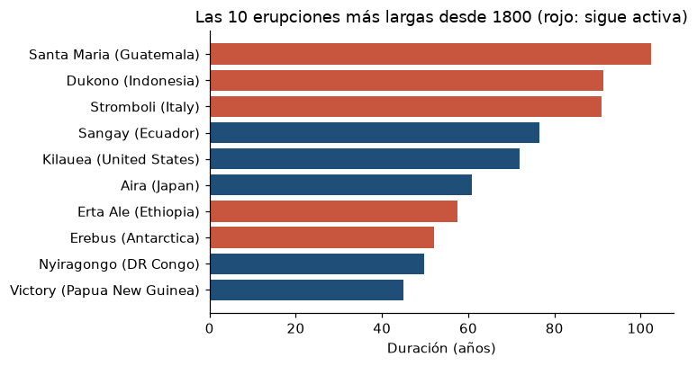
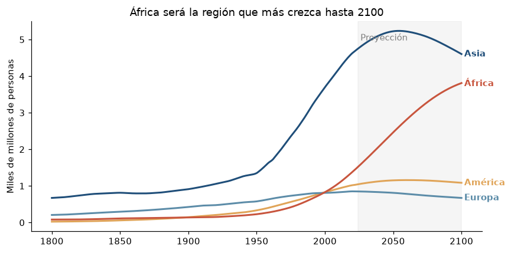
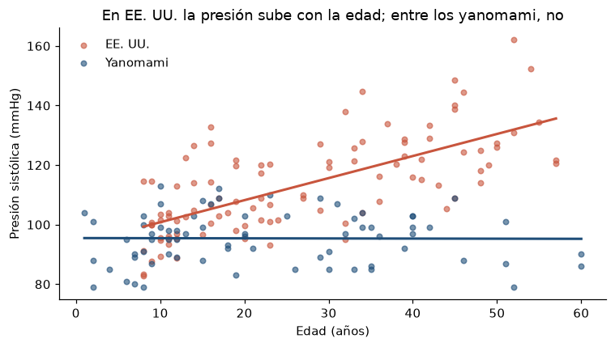
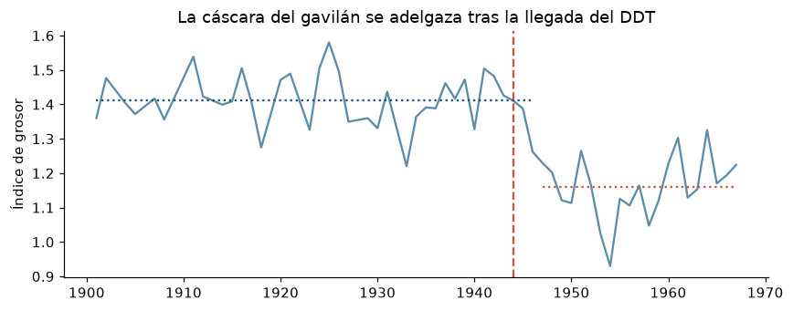

# Data Science Essentials with Python · Projects

[Español](README.md) · **English**

Hands-on evidence for Cisco Networking Academy's **Data Science Essentials with Python** course, which I completed
on 11 October 2026. Each folder solves one of the course's five *Open-Ended Projects* with a dataset from its
starter kits: questions, cleaning, charts, a model and conclusions. The notebooks are written in Spanish.

<a href="certificado/certificado.png"></a>

Certificate ID: `a8918216-17c1-4250-8055-4e4e60444427` · [Badge on Credly](https://www.credly.com/users/dayle-garcia)

## Projects

| # | Course chapter | Question | What I found |
|---|---|---|---|
| 1 | Coding for answers | [Which are the world's largest islands?](proyectos/01-islas-mas-grandes/analisis.ipynb) | Greenland is 11 times the 10th island; New Guinea is the largest in the tropics. |
| 2 | Data cleaning | [Which volcanoes have erupted the longest?](proyectos/02-erupciones-volcanicas/analisis.ipynb) | Santa María (Guatemala) has been erupting for over 100 years; Tungurahua was active almost nonstop from 1999 to 2016. |
| 3 | Data visualization | [Where will everyone live in 2100?](proyectos/03-poblacion-por-continente/analisis.ipynb) | Africa grows from 1 to 4 billion; Europe is the only region that shrinks. |
| 4 | Data modeling | [Does blood pressure always rise with age?](proyectos/04-presion-arterial-y-edad/analisis.ipynb) | In the US it rises 0.74 mmHg per year (R² 0.47); among the Yanomami, not at all. |
| 5 | Data storytelling | [Silent Spring: DDT in data](proyectos/05-primavera-silenciosa/analisis.ipynb) | Sparrowhawk eggshells got 18% thinner after DDT; birds of prey came back after 1962. |

<table>
  <tr>
    <td width="50%"></td>
    <td width="50%"></td>
  </tr>
  <tr>
    <td></td>
    <td></td>
  </tr>
</table>

## What I practiced

- **pandas:** reading CSVs, `query` filters, `groupby`, `idxmax`, `merge`, `pivot` and rolling windows.
- **Cleaning:** text dates to `datetime`, durations, missing values and lossless joins.
- **Visualization with matplotlib:** horizontal bars, end-labelled lines, twin axes and annotations.
- **Modeling with scikit-learn:** linear regression, slope, intercept and R².
- **Critical thinking:** correlation versus causation and confounding factors.

## Run it

```bash
python -m venv .venv
.venv\Scripts\activate          # on macOS or Linux: source .venv/bin/activate
pip install -r requirements.txt
jupyter notebook
```

Each notebook reads its data from its own `datos/` folder and saves its charts to `figuras/`.

## Data

The datasets come from the course starter kits. Each `datos/` folder has a `FUENTE.md` with the original citation:
Visual Capitalist, Smithsonian Global Volcanism Program, Gapminder, NHANES, *JAMA Cardiology* and
*Journal of Applied Ecology*. The code is MIT-licensed; the data belongs to its authors.

---

**Daylé García Fernández** · [Portfolio](https://dageus15.github.io/en/) · [LinkedIn](https://www.linkedin.com/in/dayle-garcia/) · [GitHub](https://github.com/DaGeus15)
