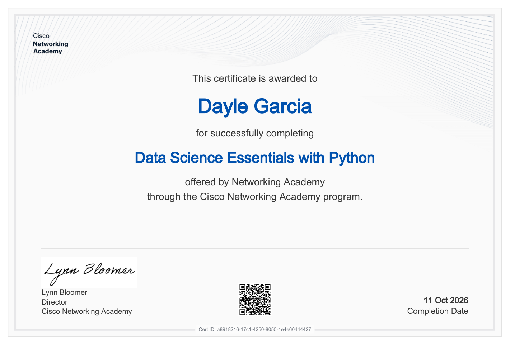
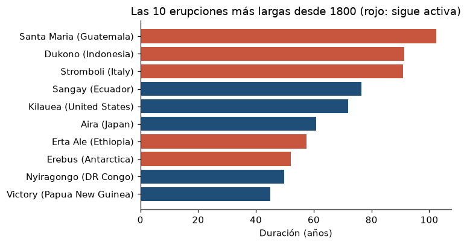
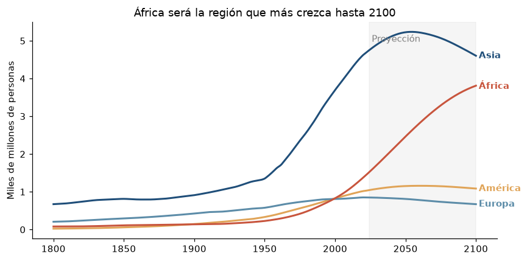
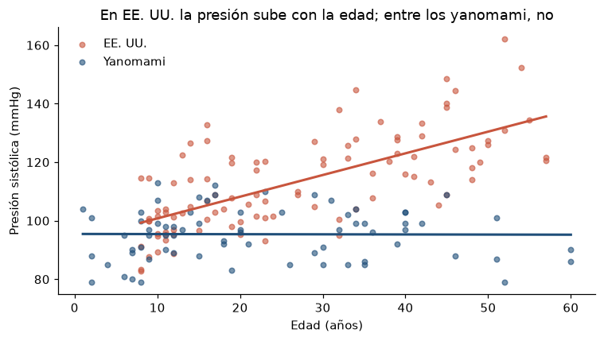
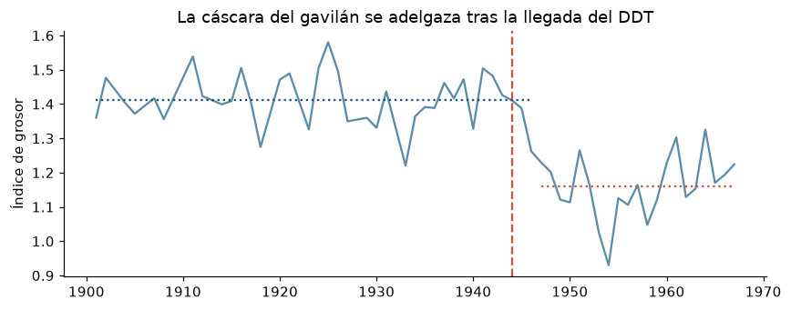

# Data Science Essentials with Python · Proyectos

**Español** · [English](README.en.md)

Evidencia práctica del curso **Data Science Essentials with Python** de Cisco Networking Academy, que terminé el
11 de octubre de 2026. Cada carpeta resuelve uno de los cinco *Open-Ended Projects* del curso con un dataset
de sus kits de inicio: preguntas, limpieza, gráficas, un modelo y conclusiones.

<a href="certificado/certificado.png"></a>

ID del certificado: `a8918216-17c1-4250-8055-4e4e60444427` · [Insignia en Credly](https://www.credly.com/users/dayle-garcia)

## Proyectos

| # | Capítulo del curso | Pregunta | Lo que encontré |
|---|---|---|---|
| 1 | Programar para responder | [¿Cuáles son las islas más grandes del mundo?](proyectos/01-islas-mas-grandes/analisis.ipynb) | Groenlandia mide 11 veces la décima isla; Nueva Guinea es la mayor del trópico. |
| 2 | Limpieza de datos | [¿Qué volcanes han tenido las erupciones más largas?](proyectos/02-erupciones-volcanicas/analisis.ipynb) | Santa María (Guatemala) lleva más de 100 años; el Tungurahua estuvo activo casi sin pausa de 1999 a 2016. |
| 3 | Visualización | [¿Dónde vivirá la gente en 2100?](proyectos/03-poblacion-por-continente/analisis.ipynb) | África pasa de 1 a 4 mil millones; Europa es la única región que baja. |
| 4 | Modelado | [¿La presión arterial sube siempre con la edad?](proyectos/04-presion-arterial-y-edad/analisis.ipynb) | En EE. UU. sube 0,74 mmHg por año (R² 0,47); entre los yanomami, nada. |
| 5 | Contar historias con datos | [Primavera silenciosa: el DDT en datos](proyectos/05-primavera-silenciosa/analisis.ipynb) | La cáscara del gavilán se adelgaza un 18 % tras el DDT; las aves rapaces vuelven tras 1962. |

<table>
  <tr>
    <td width="50%"></td>
    <td width="50%"></td>
  </tr>
  <tr>
    <td></td>
    <td></td>
  </tr>
</table>

## Qué practiqué

- **pandas:** lectura de CSV, filtros con `query`, `groupby`, `idxmax`, `merge`, `pivot` y ventanas móviles.
- **Limpieza:** fechas en texto a `datetime`, duraciones, nulos y uniones sin pérdidas.
- **Visualización con matplotlib:** barras horizontales, líneas con etiquetas al final, ejes dobles y anotaciones.
- **Modelado con scikit-learn:** regresión lineal, pendiente, intercepto y R².
- **Pensamiento crítico:** correlación frente a causa y factores de confusión.

## Cómo ejecutarlo

```bash
python -m venv .venv
.venv\Scripts\activate          # en macOS o Linux: source .venv/bin/activate
pip install -r requirements.txt
jupyter notebook
```

Cada notebook lee sus datos de su propia carpeta `datos/` y guarda las gráficas en `figuras/`.

## Datos

Los datasets vienen de los kits de inicio del curso. Cada carpeta `datos/` tiene un `FUENTE.md` con la cita
original: Visual Capitalist, Smithsonian Global Volcanism Program, Gapminder, NHANES, *JAMA Cardiology* y
*Journal of Applied Ecology*. El código está bajo licencia MIT; los datos pertenecen a sus autores.

---

**Daylé García Fernández** · [Portafolio](https://dayle.dev/es/) · [LinkedIn](https://www.linkedin.com/in/dayle-garcia/) · [GitHub](https://github.com/DaGeus15)
